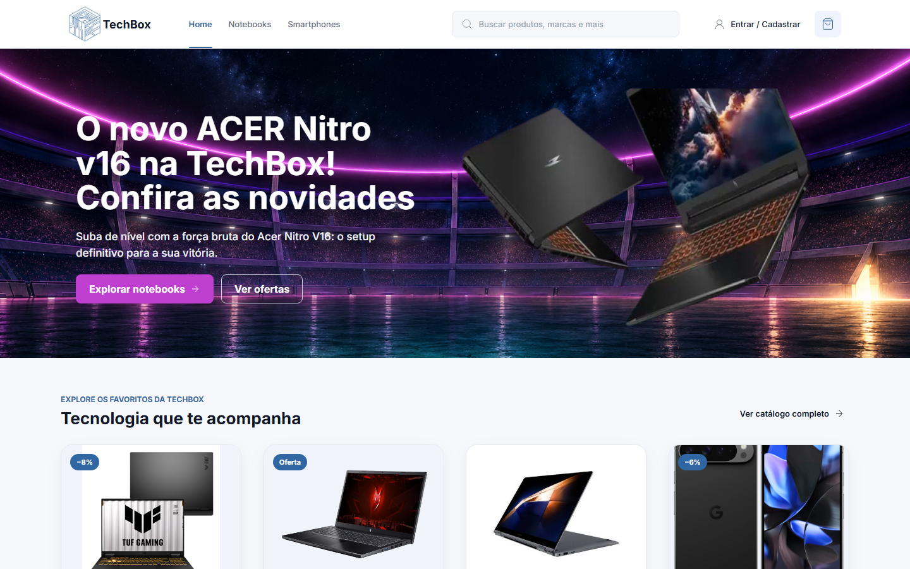
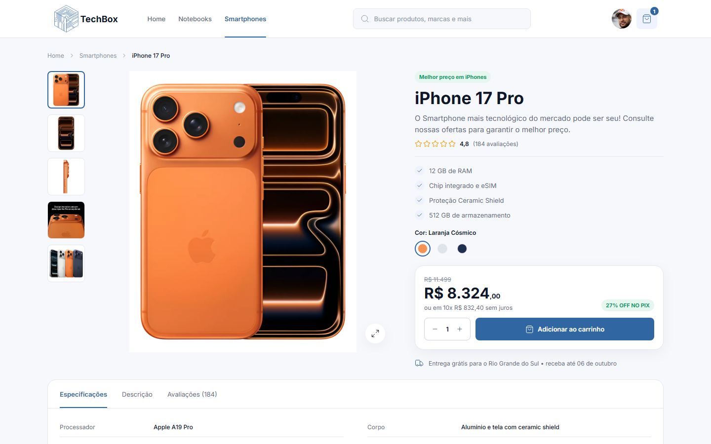
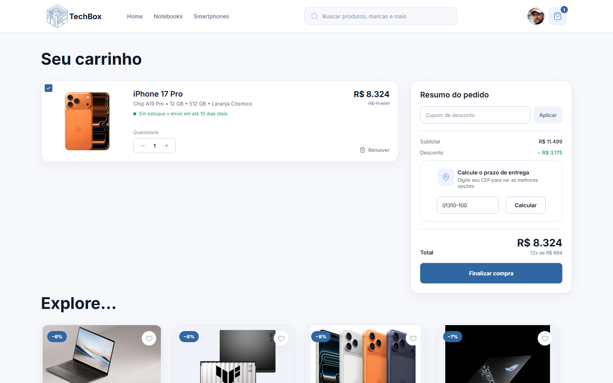
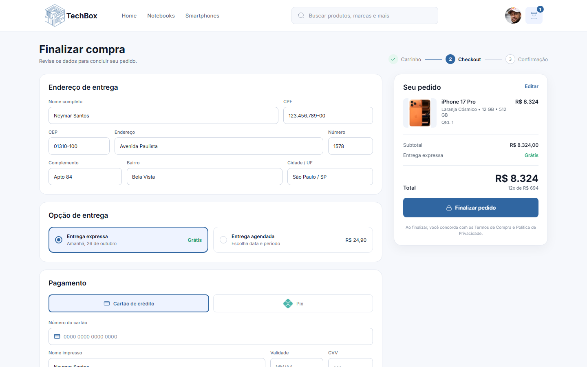
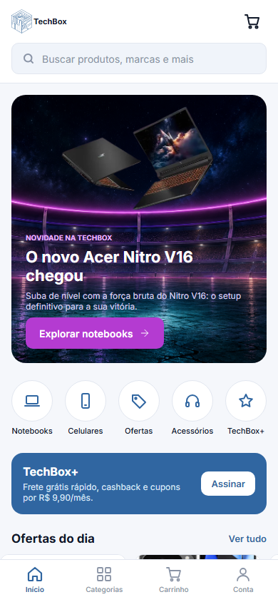
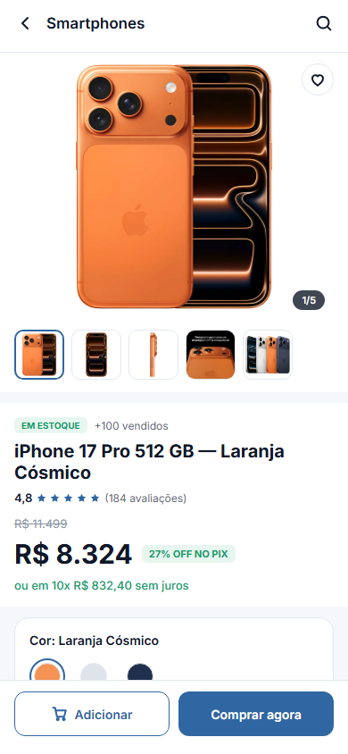
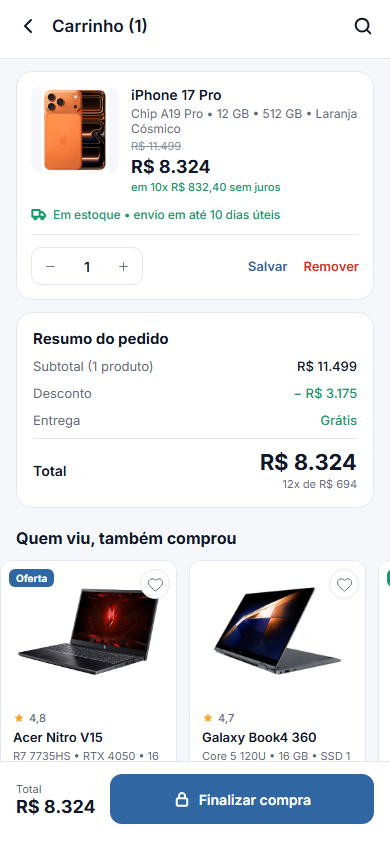

# TechBox Marketplace

Loja virtual de notebooks e smartphones feita com **HTML, CSS e JavaScript puro**, a partir do protótipo no Figma (*Marketplace Miguel*).
O site é responsivo para **desktop (1440px)**, **tablet (720px)** e **mobile (390px)**.

## Como abrir

Não precisa instalar nada. É só abrir o `index.html` no navegador
(ou usar a extensão **Live Server** do VS Code).

## O que funciona

- **Navegação** entre todas as páginas (menu, barra de abas no celular e botão de voltar)
- **Catálogo** com filtros (disponibilidade, uso, memória RAM, faixa de preço), ordenação, paginação e busca
- **Página do produto** com galeria de fotos, zoom, escolha de cor, quantidade e abas de detalhes
- **Carrinho** com quantidade, remover item, cupom de desconto e cálculo de frete por CEP
- **Checkout** com validação dos campos, entrega expressa ou agendada e pagamento por cartão ou **Pix** (QR Code, cronômetro e copia e cola)
- **Pedido confirmado** e **rastreamento** do pedido
- **Login, cadastro e recuperar senha**
- **Minha conta**: perfil, segurança, privacidade, TechBox+, cartões, endereços e histórico de compras com filtros

> Para o código não ficar muito grande, **só o iPhone 17 Pro pode ser comprado**.
> Os outros produtos aparecem nas vitrines, mas mostram um aviso de indisponível.

Cupons para testar: `TECHBOX10` (10% de desconto) e `BEMVINDO` (R$ 200 de desconto).

Os dados (carrinho, usuário, pedidos) ficam salvos no **localStorage** do navegador.

## Estrutura

```
techbox_marketplace/
├── index.html          → página inicial
├── pages/              → as outras páginas (catálogo, produto, carrinho, checkout, conta...)
├── css/
│   ├── style.css       → estilos gerais (cabeçalho, rodapé, cards, botões, modais)
│   └── *.css           → um arquivo para cada grupo de páginas
├── js/
│   ├── main.js         → cabeçalho, rodapé, carrinho, toast e modais
│   ├── produtos.js     → lista de produtos
│   └── *.js            → script de cada página
└── img/                → imagens exportadas do Figma (produtos, ícones e banners)
```

## Fotos da aplicação

### Desktop

| Home | Produto |
| --- | --- |
|  |  |

| Carrinho | Checkout |
| --- | --- |
|  |  |

### Mobile

| Home | Produto | Carrinho | Minha conta |
| --- | --- | --- | --- |
|  |  |  |  |

## Tecnologias

- HTML5
- CSS3 (Flexbox, Grid e Media Queries)
- JavaScript (DOM e localStorage)
- Fonte [Inter](https://fonts.google.com/specimen/Inter) do Google Fonts
